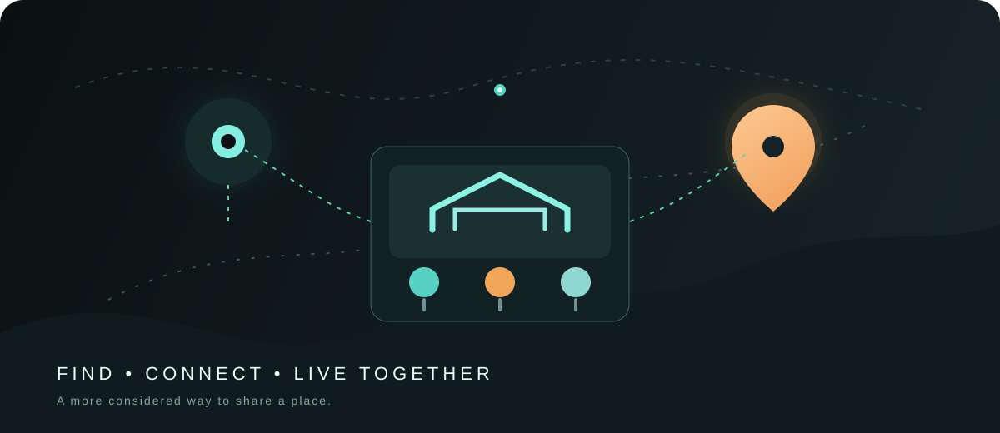
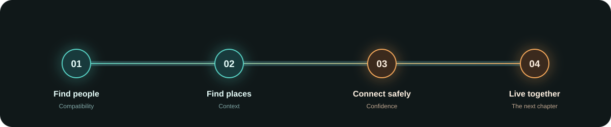

# StayMate

### Find the right person. Find the right place. Make shared living easier.

StayMate is an Android-first roommate and accommodation marketplace designed to help people discover compatible roommates, explore accommodation and build a better shared-living experience.

  
  
  

---

## About StayMate

Finding a place to live is only part of the challenge. Finding people, expectations and routines that fit is what makes shared living work.

StayMate is being built to bring those decisions into one thoughtful experience: discover people with compatible lifestyles, explore relevant rooms and accommodation, and connect with more confidence before making a move.

> **Less friction. Better compatibility. More confidence in where — and with whom — you live.**

  

## Our Vision

We believe shared living should feel more compatible, transparent and human.

StayMate’s vision is to make the journey from discovery to connection more convenient and trustworthy — giving people clearer choices, better context and privacy-conscious ways to decide whether a place and a person are right for them.

## What We Are Building

<table>
<tr>
<td width="50%" valign="top">

### 01 · Find People

Discover potential roommates through meaningful preferences and compatibility signals — not just proximity.

</td>
<td width="50%" valign="top">

### 02 · Find Places

Explore rooms, PGs and accommodation with the context needed to make a more informed choice.

</td>
</tr>
<tr>
<td width="50%" valign="top">

### 03 · Connect Safely

Build meaningful connections through communication designed with privacy and personal boundaries in mind.

</td>
<td width="50%" valign="top">

### 04 · Live Together

Manage shared expenses and household activities as a future product module for life after moving in.

</td>
</tr>
</table>

## Technology Stack

The product direction is being shaped deliberately. The list below separates what is confirmed from technologies currently being evaluated, so the public profile reflects the work accurately.

### Confirmed direction

### Planned / under evaluation

| Layer | Technologies |
| --- | --- |
| Application | React Native · Expo · TypeScript |
| Backend | Node.js · Express |
| Data & real-time | MongoDB · Socket.IO |
| Notifications | Firebase Cloud Messaging |

> Technologies in the planned section are not presented as implemented features. This section will be updated as architectural decisions are confirmed.

## Engineering Principles

| Principle | What it means for us |
| --- | --- |
| **Lightweight by default** | Keep the experience fast, focused and efficient on real devices and real networks. |
| **Security first** | Treat identity, communication and data protection as core product responsibilities. |
| **Privacy by design** | Collect, expose and retain information with purpose and restraint. |
| **Maintainable architecture** | Prefer clear boundaries, readable code and decisions that remain easy to evolve. |
| **Reliable systems** | Build dependable backend foundations with explicit failure handling and observability in mind. |
| **Accessible by intent** | Make the experience understandable and usable for as many people as possible. |
| **Meaningful testing** | Test the journeys and edge cases that matter to people, not just the happy path. |

## Development Status

| Area | Status |
| --- | --- |
| Product concept | **Defined** |
| Android-first direction | **Confirmed** |
| Public release | **Not yet announced** |
| Current milestone | **[Status to be updated]** |
| Release timeline | **[To be announced]** |

We will share progress as milestones become concrete. No completion percentages, download figures or production claims are included until they can be verified.

## Project Repositories

Official repositories will be linked here as they become available:

- **Application** — `[Repository URL to be added]`
- **Backend services** — `[Repository URL to be added]`
- **Shared tooling / documentation** — `[Repository URL to be added]`

## Join Our Journey

StayMate is being shaped by people who care about better products, better engineering and better ways to live together. Follow the organization to see the project take form, and watch for opportunities to contribute, collaborate or share thoughtful feedback.

### Better matches. Better places. Better shared living.

---

**StayMate**

*Find the right person. Find the right place. Make shared living easier.*

